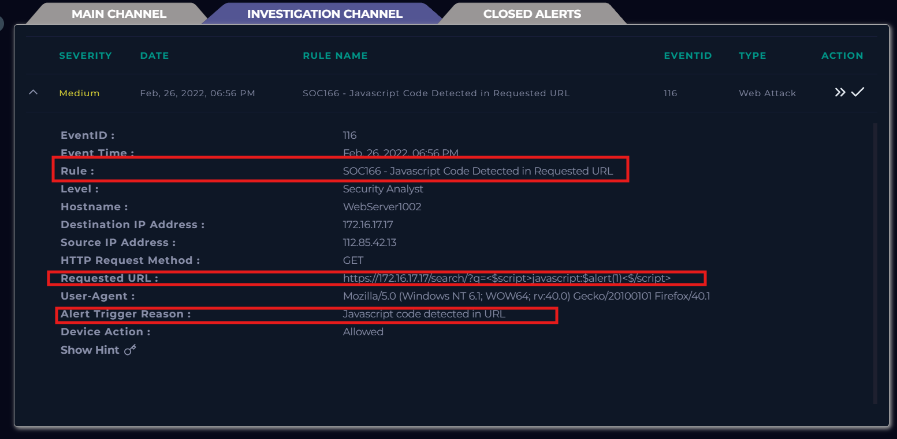

# SOC166 - Javascript Code Detected in Requested URL

## Information

Event ID: 116

Rule: SOC165 - Possible SQL Injection Payload Detected

Time: 26/02/2022, 06:56 PM

Trigger reason: Javascript code detected in URL

Target Endpoint: GET https://172.16.17.17/search/?q=

Payload: ?q=%22%20OR%201%20%3D%201%20--%20-

## Alert

Alert này thông báo rằng có 1 đợt tấn công xss vào web server. Điều tra bằng IP của hacker trong log management thử xem cuộc khai thác này có thành công hay không và liệu nó có phải là true positive hay không.

các Log ban đầu cho thấy hacker đang tìm hiểu web truy cập thành công nhiều endpoint khác nhau của web nhưng đến endpoint search với parameter “q” thì bắt đầu test lỗ hỏng. 

Nhưng khi chèn payload vào thay vì được trả về http code 200 hoặc 403 thì được trả về 302 (chuyển hướng tạm thời), có lẽ firewall cấu hình không chặn mà khi phát hiện ra request có chứa payload tấn công thì chuyển hướng qua trang cảnh báo.

Từ hành vi khám phá trang web và tốc độ gửi request, độ phức tạp payload cho thấy đây có thể là một cuộc dò lỗ hỏng và tấn công thủ công của hacker vào web service nhưng đã bị tường lửa chặn được.

Check xem cuộc tấn công này bắt đầu từ đâu, nội bộ hay internet. Kiểm tra trong EDR thì không thấy thiết bị nào có IP này.

Check ở AbuseIPDB thì được tìm thấy trong DB của họ. IP này đã bị nhiều báo cáo về các cuộc tấn công và reputation cũng rất thấp (15%). Cho thấy đây là 1 IP độc hại từ Nam Kinh, Giang Tô, Trung Quốc, ISP cung cấp IP là China Unicom Jiangsu province network.

Check ở Mail Security cũng không thấy mail nào liên quan đến việc kiểm thử bảo mật vào khoảng thời gian đó. Cho thấy đây là một cuộc tấn công trái phép từ ngoài internet vào trong mạng công ty.

## Start Playbook

- Đây là một traffic độc hại, tấn công vào web service.

- Loại lỗ hỏng là XSS.

- Không được lên plan, cuộc tấn công này từ hacker ở ngoài vào.

- Hướng tấn công là từ ngoài internet vào mạng nội bộ công ty, địa chỉ từ Nam Kinh, Giang Tô, Trung Quốc.

- Khai thác không thành công bị firewall nhận diện và điều hướng sang trang khác.

- Hacker tấn công không thành không cần escalate lên tier 2

Close Alert

Mitre

Artifacts

