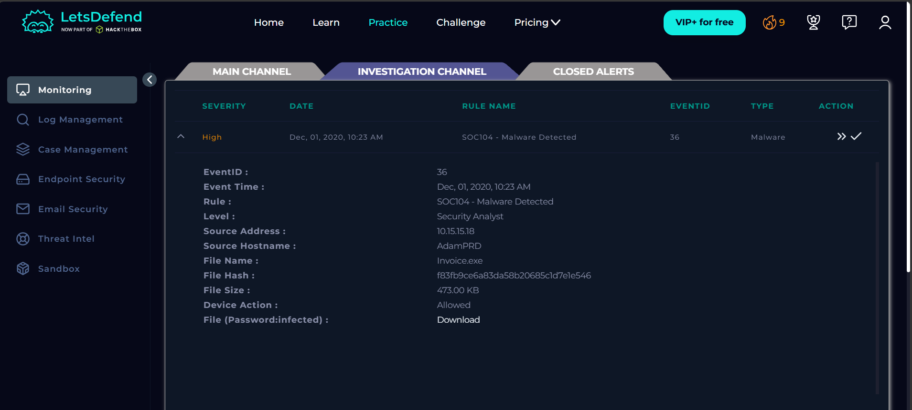

# SOC104 - Malware Detected

Template: HTB Incident report template

Nội dung:

- Tóm tắt sự cố.
- Phân tích kỹ thuât.
- Phụ lục
    - Thời gian và hành vi thực hiện
    - Chỉ báo bảo mật

# Executive Summary

- EventID : 36
- **Event Time :** Dec, 01, 2020, 10:23 AM
- **Rule :** SOC104 - Malware Detected
- Event serverity: High
- Event status:
- Affect server: AdamPRD(10.15.15.18)
- Incident review:
    - **Vào lúc 10:23 AM ngày 01/12/2022**, Đội ngũ giám sát SOC ghi nhận một thông báo **phát hiện mã độc** trong hệ thống, máy có hostname: AdamPRD(10.15.15.18) tải file độc hại **Invoice.exe** (f83fb9ce6a83da58b20685c1d7e1e546) về máy.
- Key finding:
    - Quá trình điều tra cho thấy vào lúc **10:23 AM ngày 01/12/2020,** nạn nhân đã tải file mã độc vào máy nhưng đã bị AV, EDR phát hiện nên không phát sinh hậu quả, tiến hành phân tích mã độc.
- Immediate action:
    - Bổ sung, ngăn chặn các chỉ báo bảo mật vào hệ thống AV, EDR, IDS/IPS.
- Impact:
    - Mặc dù đã malware đã bị phát hiện và ngăn chặn tuy không gây ảnh hưởng nào nhưng đã cho thấy tiềm ẩn nguy cơ kẻ tấn công có thể xâm nhập hệ thống.

# Technical Analyst

Vào lúc **10:23 AM Ngày 01/121/2020,** hệ thống log ghi nhận một máy trong mạng với IP: 10[.]15[.]15[.]18 tải một file nghi ngờ là malware. Kiểm tra mã hash của file trên **VirusTotal.com** thì được báo cáo đây là một file mã độc **Ransomware.**

Tiến hành phân tích mã độc bằng **Anyrun.com,** thì thấy mã độc này gắn file HTML với thông điệp đòi tiền chuộc dữ liệu vào extensions của trình duyệt chrome để khi nạn nhân click vào trình duyệt thì đoạn văn bản đòi tiền sẽ hiện ra. Nếu muốn lấy lại dữ liệu thì phải chuyển tiền vào ví của hacker.

Anyrun phát hiện thêm là mã độc này cũng tiến hành tạo một cờ MUTEX để tránh crash khi chạy chương trình mã độc, đây là hành vi thường thấy của các mã độc vì sợ khi người dùng click nhiều lần sẽ gây mã hóa 2 lần hoặc mã hóa cùng lúc vào một file dữ liệu khiến dữ liệu bị hư.

Thấy có kết nối đến một IP đáng nghi tại Thổ Nhĩ Kì, tìm kiếm trên VirusTotal thì thấy đây cũng là một malicious IP.

Có thể đây là địa chỉ mà mã độc sẽ gửi key khóa dữ liệu của người dùng về.

# Annex A

Technical timeline

| 10:23 AM, 01/12/2020 | Host AdamPRD download malware |
| --- | --- |

# Indicator of Compromised

| Type | Value |
| --- | --- |
| File’s name | Invoice.exe |
| File’s hash | f83fb9ce6a83da58b20685c1d7e1e546 |
| IP’s hacker | 92[.]63[.]8[.]47 |