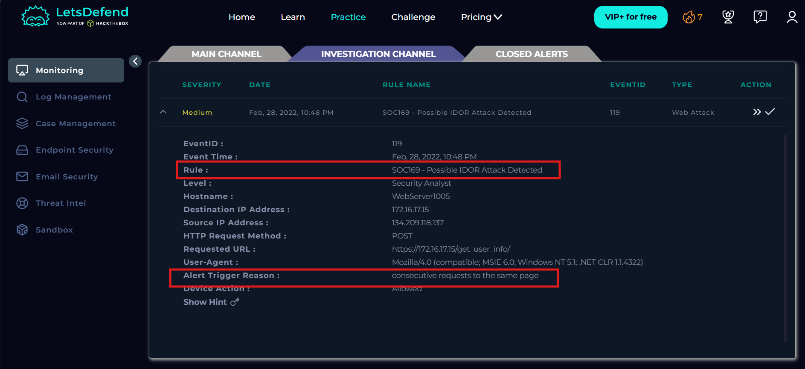

# SOC169 - Possible IDOR Attack Detected

EventID : 119

Event Time : Feb, 28, 2022, 10:48 PM

**Rule :** SOC169 - Possible IDOR Attack Detected

**Alert Trigger Reason :** consecutive requests to the same page

Target endpoint: [https://172.16.17.15/get_user_info/](https://172.16.17.15/get_user_info/)

## Alert

Hệ thống giám sát phát hiện một traffic độc hại được thông báo bởi Rule SOC169 - Possible IDOR Attack Detected, cảnh báo web server có thể đang bị tấn công IDOR, tiến hành điều tra bằng IP nguồn của request thì thấy có nhiều request cùng một URL nhưng user_id lại thay đổi. Giống như hành vi tấn công IDOR khi họ tấn công thành công thì hacker sẽ dò hết các valid id để lấy thông tin hoặc là thực hiện hành động nào đó dưới danh nghĩa người dùng hoặc tìm tài khoản admin và chiếm quyền admin để làm những việc có quyền cao hơn.

Chúng ta dễ dàng thấy được các cú yêu cầu đến server đều có status là 200 và các response saize khác nhau với mỗi id họ thử (do độ dài họ tên, email, ngày sinh,… khác nhau nên có độ dài response khác nhau. Chúng ta có thể kết luận đây là một cuộc tấn công IDOR thành công và Alert là True Positive.

Khi xác nhận được đây là cuộc tấn công thành công thì chúng  ta phải cô lập máy nạn nhân để giảm thiểu thiệt hại.

Chúng ta tiến hành kiểm tra xem đây liệu có phải là cuộc tấn công được lên plan trước hay không, check mail thì không thấy có cuộc kiểm thử nào được lên kế hoạch liên quan đến endpoint đó và check trên AbuseIPDB thì Reputation rất thấp cùng với các báo cáo về các cuộc tấn công trong quá khứ.

Nhưng check trên virustotal thì IP này chưa được các công ty lớn nào vote hết chỉ có các người dùng vote thôi và có một cáo buộc về việc Tried login SSH to [Threats6.poisoneye.info](http://Threats6.poisoneye.info) của người dùng.

## Close alert

## Mitre ATT&CK

## Artifacts

Hacker’s IP

134.209.118.137