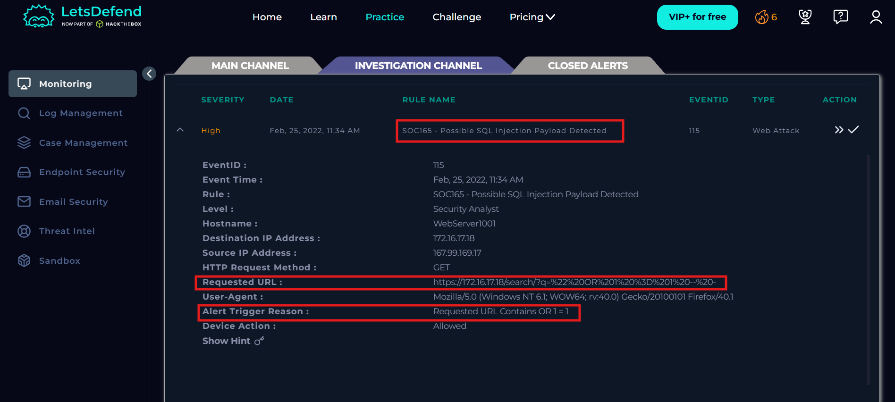

# SOC165 - Possible SQL Injection Payload Detected

## Information

Event ID: 115

Rule: SOC165 - Possible SQL Injection Payload Detected

Time: 25/02/2024, 11:34 AM

Payload: https://172.16.17.18/search/?q=%22%20OR%201%20%3D%201%20--%20-

## Alert

Đây là cảnh báo về một vụ tấn công SQLi bị phát hiện bởi dấu hiệu là URL chứa “OR 1=1”, Đây là một case điển hình của lổ hỏng SQLi khiến cho server dump ra toàn bộ dữ liệu bản ghi của truy vấn đó. 

Đầu tiên chúng ta sẽ kiểm tra xem đượt tấn công này có thành công hay không bằng cách tìm IP source trong Log Management.

 Có thể thấy được kẻ tấn công có thể truy cập dịch vụ web bình thường, tuy nhiên có rất nhiều log chèn ký tự và payload SQLi vào url request nhưng bị trả lỗi 500. Điều này cũng cho thấy có thể ở backend xử lý truy vấn và lỗi chưa tốt tiềm ẩn tồn tại lỗ hỏng SQLi nhưng ở đây họ chưa exploit được và trả về HTTP code là 500.

Nếu để ý thấy thì tần suất gửi payload rất thấp, user-agent cũng không phải là của tool scan lỗi (Nếu dùng flag —agent vẫn có thể đổi được) và các payload thuộc dạng cơ bản để dò lỗi suy ra đây có thể là một hacker dò và tấn công thủ công.

Tìm kiếm IP này ở ngoài internet hay là nội bộ tấn công vào webserver. Check IP ở EDR thì không thấy chứng tỏ nó ở ngoài internet

Check Reputation của IP source trên AbuseIPDB thì thấy Reputation bằng 0% và nhiều cuộc báo cáo về việc tấn công trái phép vào các ứng dụng khác.

Kết luận đây là một cảnh báo True Positive về một vụ tấn công từ ngoài internet vào lỗ hỏng SQL injection thủ công nhưng chưa thành công và ở phía server có rủi ro tồn tại lỗ hỏng SQL Injection thật hoặc xử lý ngoại lệ chưa tốt.

## Start Playbook

- Đây là một traffic độc hại, yah sure chắc chắn là như vậy rồi

- Thuộc dạng tấn công SQLI

- Không được lên plan vì check trong Mail Security không có cuộc diễn tập nào tấn công SQLi hay IP liên quan và check IP là malicious IP từ bên ngoài internet.

- Tấn công không thành công vì trả về toàn bộ lỗi 500 và không có dấu hiệu bị SQLi Blind chỉ là họ bỏ cuộc với vài test payload.

- Không cần escalate tier 2 vì tấn công thất bại.

## Close Arlert

## Mitre ATT&CK

## Artifacts

Hacker’s IP

Payload

167.99.169.17

?q=%22%20OR%201%20%3D%201%20--%20-