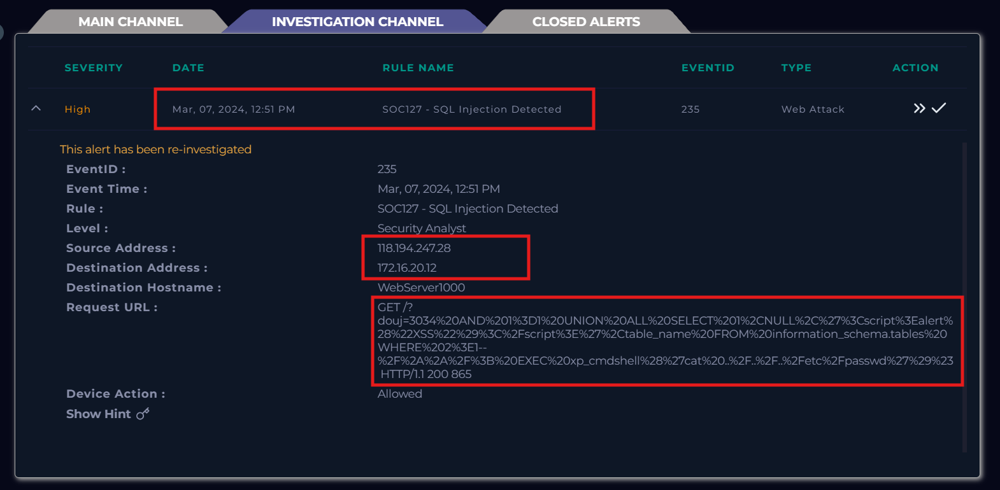

# SOC127 - SQL Injection Detected

Event ID: 235

Rule: SOC127 - SQL Injection Detected

Time: 07/03/2024, 12:51 PM

Payload: GET /?douj=3034%20AND%201%3D1%20UNION%20ALL%20SELECT%201%2CNULL%2C%27%3Cscript%3Ealert%28%22XSS%22%29%3C%2Fscript%3E%27%2Ctable_name%20FROM%20information_schema.tables%20WHERE%202%3E1--%2F%2A%2A%2F%3B%20EXEC%20xp_cmdshell%28%27cat%20..%2F..%2F..%2Fetc%2Fpasswd%27%29%23

## **Alert**

Cảnh báo này thông tin rằng một host có IP 172.16.20.12 bị tấn công SQL Injection bởi 1 IP độc hại đến từ Trung Quốc 118.194.247.28 .

## **Detection**

Đầu tiên đối với cuộc tấn công SQLI này thì chúng ta cần phải kiểm tra xem liệu nó đã tấn công thành công hay chưa bằng cách vào Log Management rồi tìm IP Source= 118.194.247.28 và Raw =?douj=3034%20AND%201%3D1%20UNION%20ALL%20SELECT%201%2CNULL%2C%27%3Cscript%3Ealert%28%22XSS%22%29%3C%2Fscript%3E%27%2Ctable_name%20FROM%20information_schema.tables%20WHERE%202%3E1--%2F%2A%2A%2F%3B%20EXEC%20xp_cmdshell%28%27cat%20..%2F..%2F..%2Fetc%2Fpasswd%27%29%23.

Để xem Log và phản hồi đầy đủ và phát hiện thêm các Log liên quan.

Đây cũng là các Log về SQL Injection vào cùng khoảng thời gian và IP nguồn IP đích, response đều trả về HTTP Code là 200 cho thấy là cuộc tấn công đều được thực hiện thành công, trong phần request thấy đều có agent là "sqlmap/1.7.2#stable ([https://sqlmap.org](https://sqlmap.org/))". Chứng tỏ kẻ tấn công đã dùng tool SQLmap để liên tục tấn công có chủ đích vào web chứ không phải dùng phương thức thủ công thông thường (do không set flag —user-agent nên mới giữ nguyên agent là SQLmap).

Tới đây chúng ta có thể kết luận đây là một Alert True Positive và để xem thử đây liệu có phải là một cuộc mô phỏng hay là cuộc kiểm tra của công ty không thì sẽ check những thông tin liên quan ở Mail security để xác định xem có nên leo thang điều tra không.

- Không có IP source 118.194.247.28 được đề cập hay liên quan

- Cũng không có thông báo gì về cuộc tấn công SQLi

Kết luận đây là một case True Positive server bị tấn công SQLI thành công có chủ đích bằng tool SQLmap từ 1 IP độc hại từ Trung Quốc.

## PlayBook

- Xác định đây là 1 traffic độc hại, tấn công vào máy chủ và được virustotal đánh giá là 1 malicios ip source

- Loại tấn công là SQLi

- Không có Plan kiểm thử trong security email

- Là 1 cuộc tấn công từ Internet(Trung Quốc) → công ty

- Là 1 cuộc khai thác thành công với các phản hồi về kẻ tấn công đều là HTTP code 200

- Để ngăn chặn sự lây lan và gairm thiểu ảnh hưởng của cuộc tấn công thì tìm EDR để cô lập thiết bị đã bị tấn công.

- Trong quy trình của Lab này có đề cập đến những trường hợp cần được can thiệp Leo thang Tier 2 với 2 trường hợp là tấn công thành công hoặc là traffic độc hại trực tiếp giữa các thiết bị trong mạng nội bộ. Trường hợp của chúng ta là bị tấn công thành công nên câu trả lời phần này là cần thiết leo thang lên Tier 2 để tiếp tục điều tra.

## **Close Alert**

## MITRE  ATT&CK

## Artifacts