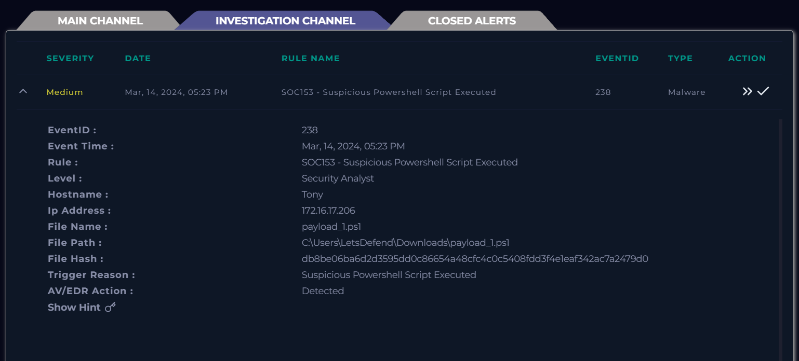

# SOC153 - Suspicious Powershell Script Executed

## Phần mềm SIEM phát hiện log có Powershell script đáng ngờ được thực thi

Cùng phân tích thông tin từ log thì chúng ta có được những thông tin như sau:

- Event Time: Thời gian xảy ra sự kiện này là 14 tháng 3 năm 2024 vào lúc 05:23 PM.
- Rule: SOC153 -  Phát hiện script powershell đáng ngờ được thực thi.
- Severity: Medium
- Hostname: Tony
- Ip address: 172.16.17.206
- File Path: C:\Users\LetsDefend\Downloads\payload_1.ps1
- File hash: db8be06ba6d2d3595dd0c86654a48cfc4c0c5408fdd3f4e1eaf342ac7a2479d0

Đầu tiên ta thấy có 1 host đang thực thi đoạn powershell có thể nó dùng để bypass tường lửa và window defend để hệ thống bảo mật tin tưởng sau đó download mã độc về và lây lan cho các máy trong mạng nên việc đầu tiên là chúng ta cần tìm host có ip 172.16.17.206 và có Hostname là Tony và cô lập ra khỏi hệ thống.

Tiếp theo chúng ta sẽ tìm xem powershell script có parent process là gì? Full đoạn lệnh đã chạy có mục đích là gì? Tại Log Management lọc với cột raw_log để xem log nào có chứa tên của file thực thi powershell script đó (payload_1.ps1).

Xem và phân tích 2 log trên thì thấy rằng người dùng máy này đã truy cập vào 1 đường dẫn lạ và tải về 1 file script độc hại vào lúc 05:22 PM.

Tìm địa chỉ IP của host thực thi để tìm thêm các log liên quan thì thấy có 1 log là DNS và 1 log OS sau 05:23 PM

Kiểm tra thì thấy có 1 lệnh DNS query ra IP và URL lạ kết luận là kết nối C2 qua giao thức DNS.

Và ngay sau đó vào lúc 05:23 PM ứng dụng đó chạy 1 script 

**"C:\Windows\System32\WindowsPowerShell\v1.0\powershell.exe" "-Command" "if((Get-ExecutionPolicy ) -ne 'AllSigned') { Set-ExecutionPolicy -Scope Process Bypass }; & 'C:\Users\LetsDefend\Downloads\payload_1.ps1\payload_1.ps1'”**

Đoạn PowerShell script này có logic là kiểm tra xem chính sách execution của hệ điều hành nếu không phải là AllSigned (chỉ chạy những ứng dụng có ký số) thì set chính sách thực thi cho tiến trình Powershell này là bypass và tải 1 file **payload_1.ps1** về máy tại đường dẫn “**C:\Users\LetsDefend\Downloads\payload_1.ps1”.** Kết luận là file đã thực thi tấn công thành công không bị AV phát hiện và cô lập.

Tìm thêm ở log management với IP source là: 172.16.17.206 và trong Raw có lệnh IWR(Invoke-WebRequest) không để xác minh là file độc hại đó có kết nối tới kênh C2.

Tiếp theo chúng ta cần phải xác minh xem là kết nối đó qua firewall được không? hay là thực thi thành công.

Và kết quả là hiển thị SUCCESS.

Ném đoạn mã hash của file lên virustotal để kiểm tra thì công cụ đánh giá là file độc hại với hành vi là sử dụng Powershell script đáng ngờ và kết nối với C2.

Thử tìm kiếm trong Email security xem thử có đợt thử nghiệm nào do tổ chức thực hiện hay không. Tìm với tên file thì không có kết quả.

Tiếp tục tìm kiếm với Powershell thử thì thấy 1 email thông báo về gửi 1 file powershell script nhưng so về thời gian và nội dung không hợp lý. Suy ra đây là 1 cuộc tấn công vào hệ thống.

## MITRE  ATT&CK

## Artifacts