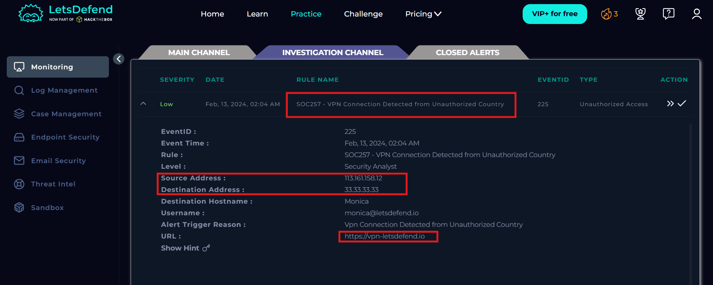

# SOC257 - VPN Connection Detected from Unauthorized Country

## Information

Event ID: 225

Rule: SOC257 - VPN Connection Detected from Unauthorized Country

Time:13/02/2024, 02:04 AM

## Alert

Đây là một cảnh báo về một kết nối VPN từ một quốc gia trái phép. Để kiểm chứng cảnh báo trên thì chúng ta cần phải điều tra trong Log Management xem những log liên quan đến IP source 113.161.158.12 này đã làm những gì.

Kết quả tìm kiếm cho thấy IP này gửi rất nhiều request đăng nhập thành công tới dịch vụ VPN nhưng khi tới bước xác thực mức 2 của tường lửa (mã OTP) thì lại failed hoàn toàn suy đoán có thể đây là một vụ tấn công do người dùng nội bộ bị lộ thông tin tài khoản/bị bruteforce và hacker không vượt qua phần xác thực mức 2 OTP.

Giả thuyết nếu bấm nhầm mã OTP thì có thể nhầm 1 - 2 lần và sau cùng phải có 1 lần nhập thành công nhưng theo kết quả điều tra cho thấy họ đã nhập sai nhiều lần và không có lần nào thành công.

Cho ta thấy đây là một True Positive alert về việc truy cập trái phép vào dịch vụ.

Dùng AbuseIPdb để check xem độ uy tín của IP gửi yêu cầu đến thì thấy IP này là 1 IP được cung cấp bởi một nhà mạng Việt Nam **vnpt** đã thực hiện rất nhiều cuộc tấn công và độ uy tín =0%.

## Start Playbook

- True Positive

- Đây là một cuộc tấn công truy cập trái phép nhưng không thành công

- Đây là một cuộc tấn công từ thiết bị bên ngoài với IP độc hại đã từng tấn công nhiều mục tiêu.

- Check IP trên AbuseIPdb thì ra độ uy tín 0% với nhiều “tiền án”.

- Như đã nói ở cuộc xâm nhập này thực hiện không thành công.

- Đăng nhập thất bại nên không khai thác được thông tin gì, Mặc dù cũng là dấu hiệu cho thấy khả năng bảo mật bị ảnh hưởng.

- Không cần thiết vì máy nạn nhân chưa bị ảnh hưởng bởi cuộc tấn công cũng chưa dính mã độc.

## Close Alert

## MITRE  ATT&CK

## Artifacts

Field

Attacker IP

Victim’s Email

Value

113.161.158.12

[monica@letsdefend.io](mailto:monica@letsdefend.io)