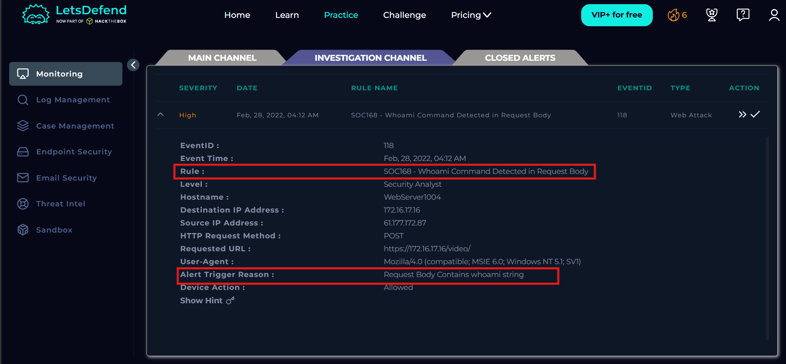

# SOC168 - Whoami Command Detected in Request Body

## Information

Event ID: 118

Rule: SOC168 - Whoami Command Detected in Request Body

Time: 28/02/2022, 04:12 AM

Trigger reason: Request Body Contains whoami string

Target Endpoint: GET https://172.16.17.16/video/

## Alert

Đây là một trường hợp cảnh báo về cuộc tấn công command injection với trigger rule là Request body chứa chuỗi whoami. Để kiểm chứng liệu alert trên có đúng hay không thì chúng ta sẽ lục lại trong log management với IP nguồn đã gửi yêu cầu đến web server xem chi tiết request và response như thế nào, liệu có thực thi thành công không.

Kiểm tra thì đúng thật là một trong những request từ IP này gửi đến thì có một request 200 có chứa ?c=whoami. So sánh response size với các response khác thì thấy chênh lệch tùy theo câu lệnh truy vấn, những câu lệnh như whoami, uname,… đều trả về size khá nhỏ tầm 910-913 nhưng câu lệnh cat /etc/passwd hay cat /etc/shadow thì trả về size 1300 - 1500. cho thấy khả năng cao là server đã bị command injection. Sau khi kiểm tra thì thấy không có động thái download malware về máy.

Kiểm tra trong email security không thấy có thông báo về kế hoạch kiểm thử nào, tiến hành check reputation của ip trên AbuseIPDB, thì họ thông báo là tìm thấy ip này trong database của họ và reputation 0% cùng với tiền án nhiều cuộc tấn công vào các hệ thống khác.

Check lại trên [VirusTotal.com](http://VirusTotal.com) thì thấy họ cũng đánh giá đây là một IP độc hại đến từ trung quốc.

Kết luận đây là một True Positive Alert về một ca tấn công bằng lỗ hỏng command injection vào webserver, thành công lấy được dữ liệu của server nếu đi xâu hơn có thể download malware, chiếm quyền admin,…

## Start Playbook

- Chắc chắn đây là một cuộc tấn công nên nó là malicous traffic.
- Loại lỗ hỏng là command injection, lệnh chèn bash script hoặc powershell cho máy chủ thực thi.
- Check email security không có thông báo về kế hoạch test bảo mật và IP nguồn là một IP độc hại thì đây không thể là một planned test.
- Với IP nguồn được cho là ở Nam Kinh, Giang Tô, Trung Quốc tấn công vào máy chủ công ty nên hưởng lưu lượng sẽ là từ internet vào mạng công ty.
- Do cuộc tấn công này thành công nên phải escalate lên Tier2 để tiếp tục điều tra sâu hơn.

MITRE ATT&CK

Artifacts